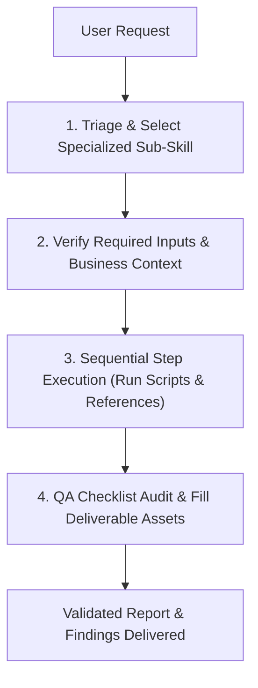

# Data Analyst Skill (`sdlc-data-analyst`)

A structured, end-to-end analytics workflow library integrating 31 domain-specific analytics skills organized across 6 core operational stages.

---

## When to use
- **Exploratory Data Analysis (EDA):** Profiling a new dataset, investigating distributions, identifying nulls, outliers, and correlations before modelling or development.
- **Data Quality & Validation:** Auditing datasets against business rules and schema constraints, or validating SQL queries for performance and correctness.
- **Metrics & Semantic Modeling:** Defining or reconciling conflicting metrics, building semantic layers, or calculating SaaS/product/e-commerce KPIs.
- **Deep-Dive Investigation:** Evaluating A/B experiments, tracking cohort retention curves, diagnosing funnel drop-offs, forecasting time series trends, or conducting structured root cause analysis.
- **Storytelling & Dashboards:** Designing dashboard specifications, building data narratives, or preparing decision-ready executive summaries.
- **Stakeholder Communication:** Gathering analytical requirements, explaining technical methodology to business leaders, or conducting pre-delivery QA checklists.

---

## Process

When activating this skill, the agent MUST follow this deterministic 4-phase execution framework:

### Phase 1: Triage & Select Specialized Sub-Skill
Identify the specific analytics problem and route to the corresponding sub-skill folder below:
1. **Data Quality & Validation:** `data-quality-audit`, `programmatic-eda`, `query-validation`
2. **Documentation & Knowledge:** `semantic-model-builder`, `analysis-documentation`, `data-catalog-entry`, `sql-to-business-logic`, `analysis-assumptions-log`, `metric-reconciliation`, `schema-mapper`
3. **Data Analysis & Investigation:** `cohort-analysis`, `segmentation-analysis`, `funnel-analysis`, `time-series-analysis`, `root-cause-investigation`, `ab-test-analysis`, `business-metrics-calculator`
4. **Data Storytelling & Visualization:** `dashboard-specification`, `data-narrative-builder`, `executive-summary-generator`, `insight-synthesis`, `visualization-builder`
5. **Stakeholder Communication:** `analysis-qa-checklist`, `impact-quantification`, `methodology-explainer`, `stakeholder-requirements-gathering`, `technical-to-business-translator`
6. **Workflow Optimization:** `analysis-planning`, `analysis-retrospective`, `context-packager`, `peer-review-template`

### Phase 2: Verify Required Inputs (`# Inputs the skill needs`)
Navigate to the selected sub-skill's `SKILL.md` and verify all inputs before taking action:
- **Dataset Path / Connection:** CSV, Parquet, SQLite, or database schema.
- **Business Grain:** Explicitly confirm what a single row represents (e.g. one user, one transaction, one session).
- **Core Definitions:** Event triggers, cohort criteria, or metric formulas.
- If required parameters are missing or ambiguous, clarify with the user before generating speculative numbers.

### Phase 3: Sequential Execution (`# Process`)
Execute the numbered steps defined in the sub-skill sequentially:
1. **Execute Pre-Built Scripts:** Run Python scripts located in `scripts/` (e.g. `data_overview.py`, `null_profiler.py`, `cohort_builder.py`, `retention_matrix.py`) in the conda `pytorch` environment.
2. **Consult Analytical References:** Cross-reference calculations against documentation in `references/` (e.g. `quality_thresholds.md`, `retention_metrics_glossary.md`).
3. **Verify Edge Cases:** Handle nulls, date/time boundaries, timezone disparities, and divide-by-zero scenarios defensively.

### Phase 4: Output Delivery (`# Output`)
- Populate the standardized report template located in `assets/` (e.g. `eda_report_template.md`, `cohort_report_template.md`, `findings_summary.md`).
- Present clear executive takeaways, risk flags, and actionable recommendations.

---

## Complete Skills Taxonomy (31 Sub-Skills)

### 1. Data Quality & Validation
| Sub-Skill | Purpose | Key Helper Scripts & References |
| :--- | :--- | :--- |
| [**programmatic-eda**](./programmatic-eda/SKILL.md) | Systematic exploratory data analysis and profiling | `scripts/data_overview.py` `scripts/null_profiler.py` `references/eda_checklist.md` |
| [**data-quality-audit**](./data-quality-audit/SKILL.md) | Data quality assessment against business rules and schema | `scripts/rule_checker.py` `scripts/freshness_checker.py` `references/rule_patterns.md` |
| [**query-validation**](./query-validation/SKILL.md) | SQL query review for logic, edge cases, and performance | `scripts/query_linter.py` `references/antipatterns_catalog.md` |

### 2. Documentation & Knowledge
| Sub-Skill | Purpose | Key Helper Scripts & References |
| :--- | :--- | :--- |
| [**semantic-model-builder**](./semantic-model-builder/SKILL.md) | Shared semantic layer for metrics, entities, and dimensions | `references/semantic_layer_patterns.md` `assets/metric_definition_template.yaml` |
| [**analysis-documentation**](./analysis-documentation/SKILL.md) | Reproducible documentation and analysis methodology logs | `assets/analysis_notebook_template.md` `references/reproducibility_checklist.md` |
| [**data-catalog-entry**](./data-catalog-entry/SKILL.md) | Standardized metadata, data dictionaries, and catalog entries | `scripts/schema_extractor.py` `assets/catalog_entry_template.md` |
| [**sql-to-business-logic**](./sql-to-business-logic/SKILL.md) | Translates SQL queries into plain business rules | `assets/business_logic_document_template.md` |
| [**analysis-assumptions-log**](./analysis-assumptions-log/SKILL.md) | Tracks analytical assumptions, sensitivities, and decisions | `assets/assumptions_log_template.md` `references/assumption_categories.md` |
| [**metric-reconciliation**](./metric-reconciliation/SKILL.md) | Traces and resolves discrepancies when metric sources disagree | `scripts/reconciliation_query.sql` `references/discrepancy_taxonomy.md` |
| [**schema-mapper**](./schema-mapper/SKILL.md) | Column-level mapping between source and target schemas | `assets/mapping_spec_template.md` `references/transformation_patterns.md` |

### 3. Data Analysis & Investigation
| Sub-Skill | Purpose | Key Helper Scripts & References |
| :--- | :--- | :--- |
| [**cohort-analysis**](./cohort-analysis/SKILL.md) | Time-based cohort retention curves and lifetime behavior | `scripts/cohort_builder.py` `scripts/retention_matrix.py` `assets/retention_matrix.html` |
| [**segmentation-analysis**](./segmentation-analysis/SKILL.md) | User/customer segmentation and behavioural profiling | `scripts/rfm_segmenter.py` `scripts/feature_encoder.py` `references/segmentation_approaches.md` |
| [**funnel-analysis**](./funnel-analysis/SKILL.md) | Multi-step conversion funnels and drop-off diagnosis | `scripts/funnel_builder.py` `scripts/dropoff_analyzer.py` `references/funnel_patterns.md` |
| [**time-series-analysis**](./time-series-analysis/SKILL.md) | Trend detection, seasonality decomposition, and forecasting | `scripts/decompose_series.py` `scripts/detect_anomalies.py` `references/time_series_methods.md` |
| [**root-cause-investigation**](./root-cause-investigation/SKILL.md) | Diagnostic tree for unexpected metric spikes or drops | `scripts/waterfall_decomposition.py` `references/investigation_playbook.md` |
| [**ab-test-analysis**](./ab-test-analysis/SKILL.md) | Statistical significance testing, SRM checks, and power sizing | `scripts/srm_checker.py` `scripts/significance_calculator.py` `references/statistical_tests_guide.md` |
| [**business-metrics-calculator**](./business-metrics-calculator/SKILL.md) | Standardized SaaS (MRR, LTV, CAC) and business KPI formulas | `scripts/metric_validator.py` `references/metric_definitions.md` |

### 4. Data Storytelling & Visualization
| Sub-Skill | Purpose | Key Helper Scripts & References |
| :--- | :--- | :--- |
| [**dashboard-specification**](./dashboard-specification/SKILL.md) | Requirements, layouts, and data contracts for BI dashboards | `assets/dashboard_spec_template.md` `references/dashboard_design_principles.md` |
| [**data-narrative-builder**](./data-narrative-builder/SKILL.md) | Transforms findings into decision-driving stories | `assets/narrative_outline_template.md` `references/narrative_structures.md` |
| [**executive-summary-generator**](./executive-summary-generator/SKILL.md) | Condenses complex analyses into 1-page executive briefs | `assets/executive_summary_template.md` `references/executive_communication_principles.md` |
| [**insight-synthesis**](./insight-synthesis/SKILL.md) | Bridges raw observations to business impact & next steps | `assets/insight_synthesis_template.md` `references/synthesis_frameworks.md` |
| [**visualization-builder**](./visualization-builder/SKILL.md) | Visual design best practices and chart selection guide | `references/chart_selection_guide.md` `references/visual_design_standards.md` |

### 5. Stakeholder Communication
| Sub-Skill | Purpose | Key Helper Scripts & References |
| :--- | :--- | :--- |
| [**analysis-qa-checklist**](./analysis-qa-checklist/SKILL.md) | Pre-delivery quality assurance checklist | `references/qa_checklist_reference.md` `assets/qa_scorecard_template.md` |
| [**impact-quantification**](./impact-quantification/SKILL.md) | Sizes commercial opportunity and ROI of recommendations | `scripts/roi_calculator.py` `references/quantification_models.md` |
| [**methodology-explainer**](./methodology-explainer/SKILL.md) | Explains analytical methods transparently to non-analysts | `assets/methodology_section_template.md` `references/explanation_archetypes.md` |
| [**stakeholder-requirements-gathering**](./stakeholder-requirements-gathering/SKILL.md) | Structured requirements intake and project scoping | `assets/requirements_brief_template.md` `references/intake_question_bank.md` |
| [**technical-to-business-translator**](./technical-to-business-translator/SKILL.md) | Translates p-values, coefficients, and variance into business impact | `assets/translation_matrix_template.md` `references/translation_glossary.md` |

### 6. Workflow Optimization
| Sub-Skill | Purpose | Key Helper Scripts & References |
| :--- | :--- | :--- |
| [**analysis-planning**](./analysis-planning/SKILL.md) | Plans hypothesis-driven, phased analytical workflows | `assets/analysis_plan_template.md` `references/planning_frameworks.md` |
| [**analysis-retrospective**](./analysis-retrospective/SKILL.md) | Post-project retrospective and methodology improvements | `assets/retrospective_template.md` `references/retrospective_prompts.md` |
| [**context-packager**](./context-packager/SKILL.md) | Packages business domain and schemas for AI pair analysis | `scripts/context_builder.py` `assets/context_pack_template.md` |
| [**peer-review-template**](./peer-review-template/SKILL.md) | Peer review scorecard for analytical code and conclusions | `assets/peer_review_template.md` `references/review_rubric.md` |

---

## Inputs the skill needs
- **Core Dataset / Target:** Path to dataset file (`.csv`, `.parquet`, `.xlsx`), SQL connection, or table schema.
- **Problem Statement:** Explicit analytical question or business objective.
- **Grain & Key Dimensions:** Definition of entity/row, date columns, grouping fields, and active status.
- **Analytical Scope:** Target timeframe, cohort boundaries, quality thresholds, or metric formulas.

---

## Output
- **Execution Log:** Step-by-step terminal outputs and intermediary results from executed Python/SQL scripts.
- **Completed Template Assets:** Populated Markdown/HTML report files corresponding to the selected sub-skill in `assets/`.
- **Actionable Synthesis:** Structured summary of insights, anomalies flagged, and concrete recommended next steps.
