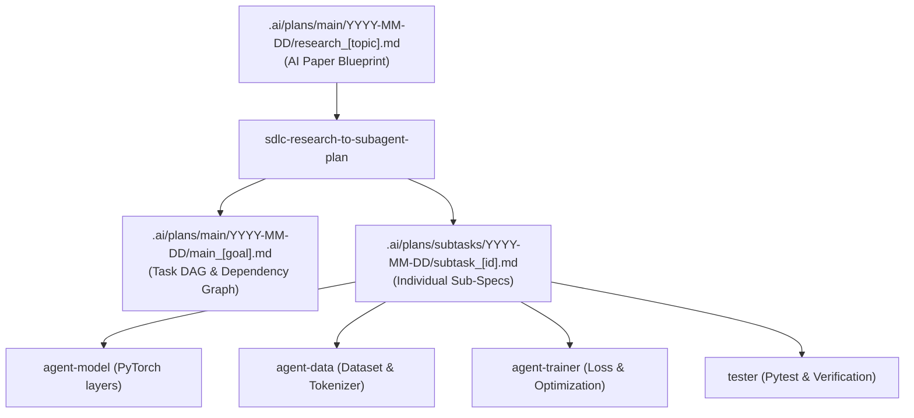

# SDLC Research to Sub-Agent Planning Protocol

> [!NOTE]
> This skill defines how the **Central Orchestrator** transforms an academic research blueprint (`.ai/plans/main/YYYY-MM-DD/research_[topic].md`) into an executable Task DAG and targeted Sub-Specs for specialized Worker Agents.

> [!CAUTION]
> ### 🚨 STRICT PROHIBITION: NO HIDDEN BACKGROUND AGENTS (`invoke_subagent` / `define_subagent`)
> Calling `invoke_subagent` or `define_subagent` is strictly forbidden across all agents (spawns hidden background agents / 'agents ngầm'). All worker agents must be dispatched interactively via dedicated Herdr terminal panes.

---

## 1. The Translation Pipeline



---

## 2. Specialized Worker Agent Archetypes

When implementing AI and machine learning architectures, do not assign the entire paper to a single monolithic Coder agent. Decompose the blueprint into specialized roles:

| Agent Identifier | Role | Focus Area | Inputs Passed via Lazy Context |
| :--- | :--- | :--- | :--- |
| `agent-model` | `CODER` | Neural network modules, attention layers, RoPE, RMSNorm, forward pass. | Tensor shapes, layer formulas, model config schema. |
| `agent-data` | `CODER` | Tokenization pipeline, batch collators, dataset streaming, data loaders. | Input format, token IDs, padding & masking logic. |
| `agent-trainer` | `CODER` | Loss function, optimizer configuration, gradient scaling, training step. | Loss equations, learning rate schedule, backward pass. |
| `agent-evaluator`| `CODER` | Validation benchmarks, accuracy / perplexity metrics, inference generator. | Benchmark datasets, evaluation rubrics, metric formulas. |
| `tester` | `TESTER` | Unit tests for tensor dimensions, gradient flow, device placement (CPU/CUDA). | Expected shapes, mock inputs, numerical assertions. |

---

## 3. Step-by-Step Orchestration Protocol

### Step 1: Interface Contract Definition (Pydantic v2)
Before dispatching any sub-agent, define the data contract between layers:
```python
from pydantic import BaseModel, Field
from typing import Optional, List, Tuple

class ModelConfig(BaseModel):
    vocab_size: int = 32000
    dim: int = 4096
    n_layers: int = 32
    n_heads: int = 32
    n_kv_heads: Optional[int] = 8
    norm_eps: float = 1e-5
```

### Step 2: Cross-Subtask Interface Tension Matrix
Ensure parallel worker agents do not produce conflicting interfaces (e.g., mismatched tensor shapes or dtype assumptions):
```text
| Interface / Tensor | Producer Agent | Consumer Agent(s) | Tension / Risk | Agreed Contract Schema |
| :--- | :--- | :--- | :--- | :--- |
| `input_ids` | `agent-data` | `agent-model` | Shape `(B, T)` vs `(T, B)` | `torch.LongTensor` of shape `(batch, seq_len)` |
| `hidden_states` | `agent-model` | `agent-trainer` | Float32 vs BFloat16 | `torch.bfloat16` normalized output |
| `loss` | `agent-trainer` | `agent-trainer` | Reduction mean vs sum | Scalar `loss.mean()` |
```

### Step 3: Lazy Context Injection
For each subtask, generate `.ai/plans/subtasks/YYYY-MM-DD/subtask_[id].md`.
**Enforce Lazy Context:**
- Do NOT dump the entire 20-page paper into every sub-agent's prompt.
- For `agent-model`: Inject ONLY Section 3 (Architecture) and the forward pass pseudo-code.
- For `agent-trainer`: Inject ONLY Section 4 (Optimization) and loss formulas.
- For `agent-data`: Inject ONLY Section 5 (Data & Preprocessing).

### Step 4: Interactive Dispatch via Herdr Workspaces
Launch each worker in an isolated Herdr git worktree pane:
```powershell
# Create isolated git worktree via native git
git worktree add -b agent/<task_id> .worktrees/agent/<task_id>

# Start interactive worker agent in dedicated pane
herdr agent start worker_<task_id> --kind agy --pane <pane_id> --cwd .worktrees/agent/<task_id> -- --dangerously-skip-permissions

# Prompt worker with specific sub-spec contract
herdr agent prompt worker_<task_id> "Read .ai/plans/subtasks/YYYY-MM-DD/<plan_id>/subtask_01_<task_id>.md and implement"
```
Worker agents report completion by outputting `[WORKER_COMPLETED]` or writing `.ai/status/<task_id>.complete`.

### Step 5: Testing & Quality Gate
Run `pytest` to verify forward pass, backward pass, and shapes:
```powershell
conda run -n pytorch pytest tests/test_model.py
```
A task is NOT complete until all tensor shape and numerical assertions pass 100%.
