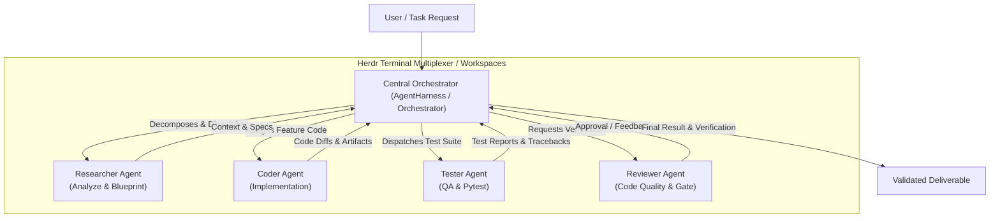

# AGENTS.md: Rules and Architecture Guidelines for AI Agents

> [!NOTE]
> This is the unified system rule file outlining the architectural guidelines, roles, and strict compliance rules for all AI Agents operating within this repository.

---
> This is the unified system rule file outlining the architectural guidelines, roles, and strict compliance rules for all AI Agents operating within this repository.

---

## 1. System Architecture: Central Orchestrator Pattern

The system uses a **Central Orchestrator Pattern** to coordinate specialized **Worker Agents**:



| Role | Identifier | Key Responsibilities |
| :--- | :--- | :--- |
| **Orchestrator** | `orchestrator` | • Receives the goal from the User.<br/>• Decomposes the goal into a Task DAG.<br/>• **CRITICAL RULE:** NEVER write or edit code files directly. Only generate Sub-Specs (`.ai/plan/[task_id].md`), wait for approval, create a git worktree, and setup a Herdr workspace.<br/>• **DO NOT run `agy` in the background**. Launch interactively (`herdr agent start worker_[task_id] --kind agy --pane <pane_id>`) and send prompts via `herdr agent prompt`.<br/>• **MANDATORY:** Must check if the CLI ran and wait for the completion signal before proceeding. |
| **Researcher** | `researcher` | • Explores the codebase, dependencies, and available libraries.<br/>• Designs architectural blueprints before implementation begins. |
| **Coder** | `coder`, `agent-backend`, etc. | • Implements feature code, strictly adhering to PEP 8, typing, and the provided spec.<br/>• **Expert Rule:** The Orchestrator should dynamically configure this sub-agent as a domain expert (e.g., `agent-backend` for APIs). |
| **Tester** | `tester` | • Writes unit and integration tests using `pytest` and `pytest-asyncio`.<br/>• Validates a 100% pass rate before hand-off. |
| **Reviewer** | `reviewer` | • Evaluates code diffs, linting, typing, conventions, and security. |

---

## 2. Environment & Tooling Standards

All agents must strictly adhere to the following environment rules:

### 2.1. Conda Environment
- **Mandatory:** Always use the **`pytorch`** conda environment.
- Run commands using: `conda run -n pytorch <command>`

### 2.2. Python Standards
- **Version:** `>= 3.10`
- **Typing:** 100% type hints on all public interfaces (use Pydantic v2 for schemas).
- **Style:** Black (100 line length), isort (profile black), flake8 (no unused imports or silent exception swallowing).
- **Documentation:** Do not delete existing, unrelated comments or docstrings.

### 2.3. Testing Gates
- All new features or bug fixes must include unit tests.
- Run tests via `conda run -n pytorch pytest`.
- **Gatekeeper Rule:** A task cannot be marked as complete if any tests fail.

---

## 3. Git Operations: Direct agy-cli Control
All agents must strictly adhere to the following environment rules:

### 2.1. Conda Environment
- **Mandatory:** Always use the **`pytorch`** conda environment.
- Run commands using: `conda run -n pytorch <command>`

### 2.2. Python Standards
- **Version:** `>= 3.10`
- **Typing:** 100% type hints on all public interfaces (use Pydantic v2 for schemas).
- **Style:** Black (100 line length), isort (profile black), flake8 (no unused imports or silent exception swallowing).
- **Documentation:** Do not delete existing, unrelated comments or docstrings.

### 2.3. Testing Gates
- All new features or bug fixes must include unit tests.
- Run tests via `conda run -n pytorch pytest`.
- **Gatekeeper Rule:** A task cannot be marked as complete if any tests fail.

---

## 3. Git Operations: Direct agy-cli Control

- **Separation of Concerns**: Python source code (`src/`) must NEVER call Git programmatically (e.g., no `subprocess` or `GitPython`).
- **Direct Execution**: All Git actions must be performed directly via the `agy` CLI in the terminal.
- **Branch Protection**: Never commit directly to `main`. Always work on a dedicated branch (`feat/...`, `fix/...`).
- **Separation of Concerns**: Python source code (`src/`) must NEVER call Git programmatically (e.g., no `subprocess` or `GitPython`).
- **Direct Execution**: All Git actions must be performed directly via the `agy` CLI in the terminal.
- **Branch Protection**: Never commit directly to `main`. Always work on a dedicated branch (`feat/...`, `fix/...`).
- **Conventional Commits**: Use `feat:`, `fix:`, `test:`, `docs:`, `refactor:`. Always inspect `git status` and `git diff` before committing.
- **Rule Sync on Main Only**: Updates to standard rules and SDLC skills must only be pulled/synced into the `main` branch, not in-flight feature branches.

---

## 4. Herdr Workspace Setup (`herdr.dev`)

Herdr is the terminal multiplexer used for AI agents to maintain persistent sessions. Each worker agent should run in an isolated pane/tab.

- **Windows (PowerShell - Recommended):** `powershell -ExecutionPolicy Bypass -c "irm https://herdr.dev/install.ps1 | iex"`
- **Windows (CMD):** `curl.exe -fsSLo install.cmd https://herdr.dev/install.cmd && install.cmd && del install.cmd`
- **Unix/WSL:** `curl -fsSL https://herdr.dev/install.sh | sh`

---

## 5. Task Lifecycle & Context Passing

- **Lifecycle:** `[PENDING] --> [RUNNING] --> [VALIDATING] --> [COMPLETED] / [FAILED] / [BLOCKED]`
- **Context Passing:** The Orchestrator must provide the worker with the overall goal, specific instructions, and outputs from upstream tasks. If a task fails, record the error and optionally trigger a self-correction loop.

---

## 6. SDLC Skills Protocol (`.agents/skills/`)

Agents MUST ONLY read and apply specific skills that are relevant to their task.

### 6.1. Pre-Task Phase
- `sdlc-pretask-checklist`: Verify clean tree, checkout branch, breakdown requirements.
- `sdlc-architecture-planner`: Survey codebase, define Pydantic schemas, plan DAG.
- `sdlc-subtask-specifier`: Generate sub-specs assessing Criticality, Risk, and Function/TestCase Specs.

### 6.2. In-Task Phase
- `sdlc-clean-code-standards`: Follow PEP 8, Black, type safety.
- `sdlc-test-driven-development`: Write tests covering happy paths and edge cases.

### 6.3. Post-Task Quality Gate
- `sdlc-posttask-quality-gate`: Ensure 100% pytest pass rate, run linters, and inspect git diffs.
- `sdlc-security-audit`: Check for leaked secrets and injection vulnerabilities.
- `sdlc-conventional-commit`: Commit code directly via the terminal using conventional naming.

---

## 7. Orchestrator CLI Commands

```powershell
# Check agy CLI connectivity
conda run -n pytorch harness-agent check

# Initialize rules & skills for a new repository
conda run -n pytorch harness-agent init "..\new-project"

# Sync rule updates (MUST BE ON MAIN BRANCH)
conda run -n pytorch harness-agent sync "..\new-project"
```

---

## 8. Language & Communication Standards

- **Code, Docs, & Plans**: All generated plans, specs, code, and docs MUST be written in **English**.
- **Chat**: Agents should communicate with the user in the user's preferred language (e.g., Vietnamese) when responding in the chat UI.
