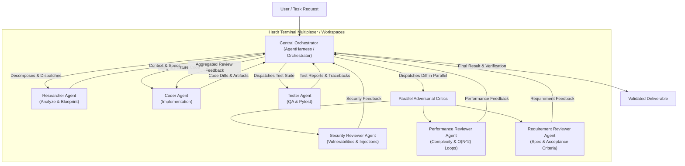
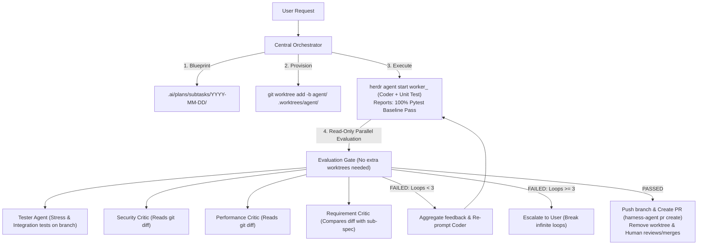

# AGENTS.md: Rules and Architecture Guidelines for AI Agents

> [!NOTE]
> This is the unified system rule file outlining the architectural guidelines, roles, and strict compliance rules for all AI Agents operating within this repository.

> [!CAUTION]
> ### 🚨 RULE 0: ZERO-TOLERANCE CODE-WRITING LOCK FOR ORCHESTRATOR
> **When operating via `agy` or acting as the Central Orchestrator, YOU ARE STRICTLY PROHIBITED FROM DIRECTLY WRITING, MODIFYING, OR REFACTORING APPLICATION SOURCE CODE (`src/`, `tests/`, etc.).**
>
> If the user requests to "implement feature X", "fix bug Y", "write code", or "refactor":
> 1. **DO NOT touch application code directly.** Calling `replace_file_content`, `apply_patch`, or `write_to_file` on application code files is a critical system violation.
> 2. **DO NOT write code yourself.** Coding is exclusively the responsibility of a dedicated **Coder Worker Agent**.
> 3. **FORBIDDEN TOOLS (`invoke_subagent`, `define_subagent`):** Calling `invoke_subagent` or `define_subagent` is strictly forbidden (spawns hidden background agents / 'agents ngầm'). All worker agents must be dispatched interactively via Herdr terminal panes.
> 4. **YOUR ORCHESTRATOR WORKFLOW IS STRICTLY**:
>    - **Decompose & Plan**: Formulate a Task DAG with mandatory `plan_id` in `.ai/plans/main/YYYY-MM-DD/main_[plan_id].md` and Sub-Specs in `.ai/plans/subtasks/YYYY-MM-DD/[plan_id]/subtask_01_[task_id].md`.
>    - **Wait for User Approval**: Present the plan to the user before any workspace setup or worker launch.
>    - **Setup Workspace**: Create an isolated git worktree (`git worktree add -b agent/<task_id> .worktrees/agent/<task_id>`).
>    - **Dispatch to Worker**: Launch a specialized Coder Agent interactively (`herdr agent start worker_[task_id] --kind agy --pane <pane> -- --dangerously-skip-permissions`) and prompt via `herdr agent prompt worker_[task_id] "..."`.
>    - **Quality Gate & Critics**: Dispatch diffs in parallel to the 3 Adversarial Critics and verify 100% pytest pass rate.

---

## STANDARD AGENT RBAC MATRIX (ROLE-BASED ACCESS CONTROL)

| Responsibility / Capability | Coder Worker | Tester / Critics | Central Orchestrator | User (Human) |
| :--- | :---: | :---: | :---: | :---: |
| **Formulate Task DAG & Spec (`.ai/plans/`)** | ❌ | ❌ | ✅ | 🔄 Approve / Amend |
| **Create / Remove Git Worktree** | ❌ | ❌ | ✅ | ❌ |
| **Dispatch Panes via Herdr** | ❌ | ❌ | ✅ | ❌ |
| **Modify Application Source Code** | ✅ *(In Worktree only)* | ❌ | 🚫 *(FORBIDDEN - Rule 0)* | ❌ |
| **Run `pytest` & Self-Tests** | ✅ | ✅ | 🔍 *(Read test reports only)* | ❌ |
| **Quality Evaluation (Adversarial Review)** | ❌ | ✅ *(Read-only diffs)* | 🔍 *(Aggregate feedback)* | ❌ |
| **Open Pull Request (`harness-agent pr create`)** | ❌ | ❌ | ✅ | ❌ |
| **Merge into Protected Branch (`main`/`dev`)** | ❌ | ❌ | 🚫 **(STRICTLY FORBIDDEN)** | 👑 **(Review & Merge)** |

---

## 4-TIER ARCHITECTURAL CONSTRAINTS & WORKFLOW PROTOCOL

### Tier 1: Infrastructure & Tool-Level Guardrails
- **Zero Root-Repo Mutations:** The Central Orchestrator is strictly forbidden from directly modifying any project files in the root directory.
- **Internal Subagent Lockout:** Internal AGY subagent mechanisms (`invoke_subagent`, `define_subagent`) are disabled in the CLI/Orchestrator configuration to prevent AI from bypassing Herdr and mutating the root repository.
- **Mandatory Git Worktree Isolation:** Every subtask modifying code MUST run in an isolated Git Worktree managed via native `git worktree`:
  `git worktree add -b agent/<task_id> .worktrees/agent/<task_id>`
- **Multiplexer Workspace Protocol:** All workers must be launched in explicit Herdr panes:
  `herdr agent start worker_<task_id> --kind agy --pane <pane_id> --cwd .worktrees/agent/<task_id> -- --dangerously-skip-permissions`
- **Socket/Prompt Communication:** Orchestrator communicates with workers strictly via Herdr socket and explicit prompts (`herdr agent prompt worker_<task_id> "..."`).

### Tier 2: Role Isolation & Anti-Role-Drift
- **Dedicated Role Prompts:** Never share the Orchestrator's `AGENTS.md` with Worker Agents. Every sub-agent role has its dedicated prompt/skill file:
  - Coder Worker: `.agents/skills/coder_worker.md`
  - Adversarial Critic: `.agents/skills/critic_agent.md`
  - Tester Agent: `.agents/skills/tester_worker.md`
- **Role Anchoring (Mandatory First Prompt Context):** Every prompt dispatched to a worker MUST begin with an explicit role anchor:
  - Coder: `"[SYSTEM CONTEXT: You are a leaf implementation worker. You CANNOT plan or dispatch other agents. Only write code and run tests in your worktree.]"`
  - Critic: `"[SYSTEM CONTEXT: You are an Adversarial Critic Agent operating strictly in READ-ONLY mode. You CANNOT modify code or dispatch agents. You only evaluate git diffs and code against specifications.]"`
  - Tester: `"[SYSTEM CONTEXT: You are a QA & Tester Worker Agent. You CANNOT orchestrate or modify core application logic. You write unit/integration tests and verify test coverage in your worktree.]"`
- **Strict Leaf Worker Boundaries:** Leaf workers are strictly execution engines; they cannot orchestrate, design architectures, or spawn sub-agents.
- **Read-Only Critics:** Adversarial Critics (Security, Performance, Requirements) operate strictly in READ-ONLY mode and evaluate git diffs only.

### Tier 3: Anti-Spinlock, Timeout & Loop Truncation
- **Anti-Deadlock & Passive Waiting Ban:** DO NOT emit stream-of-consciousness waiting loops (e.g., "Let's wait for notification..."). The Orchestrator must actively query pane status.
- **Hard Timeout Ceiling:** Enforce a hard timeout ceiling (60s–120s per socket/pane poll, 10–15 minutes total subtask max). If a worker is non-responsive or hangs, raise a `TimeoutError` instead of waiting indefinitely.
- **Loop Truncation (Max 3 Rejection Cycles):** Maximum **3 iteration loops** between Coder and Critics/Pytest on any single subtask. If defects persist after 3 remediation cycles, the Orchestrator MUST abort immediately and escalate to the human User with complete error and critic traces.

### Tier 4: Human-in-the-Loop (HITL) & Automated PR Gate
- **Strict Automated Merge Lock:** The Orchestrator and all worker scripts are **STRICTLY FORBIDDEN** from executing `git merge main`, `git merge master`, or `git merge dev`. Direct commits to protected branches are hard-blocked.
- **Human-Only Merge Authority:** Merging code into `main` or `dev` is exclusively reserved for the human user.
- **Automated PR Gate Protocol:** Upon final approval (100% pytest pass + 3 Critics PASS):
  1. Push feature branch to remote: `git push -u origin agent/<task_id>`
  2. Create Pull Request using CLI tool: `conda run -n pytorch harness-agent pr create --base main`
  3. Clean up the isolated worktree: `git worktree remove .worktrees/agent/<task_id>`
  4. Provide the PR link directly to the User in chat for manual review and merge authorization.

---

## 1. System Architecture: Central Orchestrator Pattern

The system uses a **Central Orchestrator Pattern** to coordinate specialized **Worker Agents**:



| Role | Identifier | Key Responsibilities |
| :--- | :--- | :--- |
| **Orchestrator** | `orchestrator` | • Receives the goal from the User.<br/>• Decomposes the goal into a Task DAG.<br/>• **CRITICAL RULE:** NEVER write or edit code files directly. Wait for approval, and create an isolated git worktree via native git (`git worktree add -b agent/<task_id> .worktrees/agent/<task_id>`).<br/>• **CRITICAL RULE (Mandatory Plan ID & Local Storage):** DO NOT create UI Artifacts. MUST explicitly write all plans directly to `.ai/plans/main/YYYY-MM-DD/` and `.ai/plans/subtasks/YYYY-MM-DD/` using standard file paths. Every plan MUST declare a unique `plan_id` (e.g., `plan_[feature_name]`). Master Task DAGs MUST be stored as `.ai/plans/main/YYYY-MM-DD/main_[plan_id].md` with YAML frontmatter containing `plan_id`. Individual Sub-Specs MUST be stored in dedicated plan folders with 2-digit zero-padded numbers: `.ai/plans/subtasks/YYYY-MM-DD/[plan_id]/subtask_01_[task_id].md` referencing both `Plan ID: [plan_id]` and `Task ID: [task_id]`. This prevents file overwriting across multiple plans and guarantees clean numerical ordering.<br/>• **CRITICAL RULE (Sub-Agent Domain Expertise):** Every sub-agent MUST be a dedicated domain expert focused exclusively on that 1 assigned task and MUST strictly adhere to system rules.<br/>• **CRITICAL RULE (FORBIDDEN TOOLS - No Hidden Background Subagents):** Calling `invoke_subagent` or `define_subagent` is strictly forbidden (spawns hidden background agents / 'agents ngầm'). All worker agents MUST be dispatched interactively via dedicated Herdr terminal panes.<br/>• **DO NOT run `agy` in the background**. Launch interactively (`herdr agent start worker_[task_id] --kind agy --pane <pane_id> -- --dangerously-skip-permissions`) and send prompts via `herdr agent prompt worker_[task_id] "..."`.<br/>• **MANDATORY Completion Contract & Timeout:** Must monitor worker execution. Worker signals completion by outputting `[WORKER_COMPLETED]` or writing `.ai/status/<task_id>.complete`. Orchestrator enforces a strict timeout ceiling (10–15 minutes max) to prevent deadlocks if the worker hangs or prompts for input. |
| **Researcher** | `researcher` | • Explores the codebase, dependencies, and available libraries.<br/>• Designs architectural blueprints before implementation begins. |
| **Coder** | `coder`, `agent-backend`, etc. | • Implements feature code, strictly adhering to PEP 8, typing, and the provided spec.<br/>• **CRITICAL RULE ("Patch, Never Regenerate"):** For existing files, MUST NEVER rewrite or overwrite the entire file; MUST ONLY apply minimal diff hunks using patch tools (`apply_patch`, `replace_file_content`, `multi_replace_file_content`). Full-file overwrites on existing files are strictly tool-locked. For newly created files (new modules or tests), `write_to_file` is explicitly permitted.<br/>• **Domain Expert Rule:** The Orchestrator configures this sub-agent as a specialized domain expert (e.g., `agent-backend` for APIs) strictly dedicated to its 1 assigned subtask and compliant with all quality gates. |
| **Tester** | `tester` | • Writes unit and integration tests using `pytest` and `pytest-asyncio`.<br/>• Validates a 100% pass rate before hand-off. |
| **Security Reviewer** | `security_reviewer`, `security-reviewer` | • Evaluates code diffs and files for vulnerabilities, injection flaws (SQLi, shell injection, XSS), hardcoded secrets, and unsafe deserialization. |
| **Performance Reviewer** | `performance_reviewer`, `performance-reviewer` | • Evaluates code diffs for algorithmic efficiency, nested loops (O(N^2) complexity), memory leaks, and performance bottlenecks. |
| **Requirement Reviewer** | `requirement_reviewer`, `requirement-reviewer` | • Evaluates code against functional specifications, acceptance criteria, and sub-spec contracts. |
| **Reviewer** | `reviewer` | • Evaluates code diffs, linting, typing, conventions, and security.<br/>• Verifies that code modifications are atomic diff patches rather than full-file regenerations (retained for backward compatibility). |

### 1.1. Adversarial Critics Review Protocol & Workflow Optimization
When a **Coder** completes a feature implementation or code change:
1. **Parallel Dispatch**: The Orchestrator automatically extracts the code diff / output and dispatches it concurrently to all 3 adversarial critics (`Security Reviewer`, `Performance Reviewer`, `Requirement Reviewer`) in parallel via `asyncio.gather`.
2. **Specialized Scrutiny**: Each critic focuses exclusively on its domain of expertise without overlapping biases.
3. **Feedback Aggregation**: The Orchestrator aggregates all critic evaluations into an `AggregatedCriticReview`.
4. **Coder / Patcher Remediation**: If defects or vulnerabilities are detected (e.g., SQL injection or quadratic loops), the aggregated feedback is routed directly back to the Coder / Patcher for remediation.
5. **Loop Truncation & Escalation**:
   - **Maximum Rejection Cycles**: 3 iterations.
   - If critics or test gates reject the submission for 3 consecutive cycles, the loop truncates immediately and escalates to the human user with diagnostic traces.



---

## 2. Environment & Tooling Standards

All agents must strictly adhere to the following environment rules:

### 2.1. Conda Environment
- **Mandatory:** Always use the **`pytorch`** conda environment.
- Run commands using: `conda run -n pytorch <command>`

### 2.2. Python Standards
- **Version:** `>= 3.10`
- **Typing:** 100% type hints on all public interfaces (use Pydantic v2 for schemas).
- **Style:** Black (100 line length), isort (profile black), flake8 (no unused imports or silent exception swallowing).
- **Documentation:** Do not delete existing, unrelated comments or docstrings.

### 2.3. Testing Gates
- All new features or bug fixes must include unit tests.
- Run tests via `conda run -n pytorch pytest`.
- **Gatekeeper Rule:** A task cannot be marked as complete if any tests fail.

### 2.4. Tool-Locking & Patching Policy ("Patch, Never Regenerate")
- **Patch-Only Rule for Existing Files:** All code modifications to existing files must be executed exclusively via diff hunks using patch-based tools (`apply_patch`, `replace_file_content`, `multi_replace_file_content`). Regenerating or rewriting whole files causes context rot, hallucination, and loss of unrelated comments/functions.
- **File Creation Exception:** `write_to_file` is strictly permitted ONLY for creating brand-new files (e.g., newly scaffolded modules, schemas, or test suites) that do not yet exist on disk.
- **Tool-Locking Enforcement:** Worker agents (especially Coder and Reviewer) are tool-locked against full-file overwrites on existing files (e.g., calling `write_to_file` with `Overwrite=true` on files that already exist). Any attempt to overwrite an entire existing file in one go will be rejected by the orchestrator and fail the quality gate.
- **Permitted Edit Tools:** For existing files: `apply_patch`, `replace_file_content`, `multi_replace_file_content`. For new files: `write_to_file`.

---

## 3. Git Operations: Terminal Execution & Tool Boundaries

- **Separation of Concerns & Tool Boundaries**:
  - **Python Source Code**: Source code (`src/`) must NEVER invoke Git programmatically (e.g., no `subprocess` or `GitPython`).
  - **Herdr Multiplexer**: Manages terminal panes and interactive worker processes. Workspace isolation is managed via native Git worktrees (`git worktree add -b agent/<task_id> .worktrees/agent/<task_id>`).
  - **Standard Git & GitHub CLI**: All repository Git operations (status, diff, staging, commits, remote pushes, and PR creation via `git` and `gh`) must be executed directly in the terminal shell of the active pane.
- **Strict Branch Protection & Automated Merge Lock**:
  - **Protected Branches:** `main`, `master`, `dev`, `develop`.
  - **NO AUTOMATED MERGING:** All AI agents (Orchestrator, Coder, Tester) and scripts are **STRICTLY FORBIDDEN** from automatically merging feature or bugfix branches into `main` or `dev`.
  - **NO DIRECT COMMITTING:** Committing directly to `main`, `master`, `dev`, or `develop` is strictly blocked (enforced via `.pre-commit-config.yaml` `no-commit-to-branch` hook).
  - **HUMAN-ONLY MERGE AUTHORITY:** Merging code into `main` or `dev` is exclusively reserved for the human user.
  - **Dedicated Branches Only:** Always work exclusively on dedicated branches (`feat/...`, `fix/...`, `agent/...`).
- **Conventional Commits & Pre-Commit Hook Recovery**:
  - Use conventional prefixes: `feat:`, `fix:`, `test:`, `docs:`, `refactor:`. Always inspect `git status` and `git diff` before committing.
  - **Pre-Commit Hook Abort Handling**: Pre-commit hooks (`black`, `isort`, `flake8`) automatically run upon `git commit`. If hooks modify/reformat files or abort the commit:
    1. Inspect the hook output.
    2. Re-stage the modified files: `git add .`
    3. Re-run the commit command: `git commit -m "..."`
    4. Only proceed to push after the commit successfully finishes with exit code 0.
- **Automated Remote Push & Pull Request Creation**:
  - After each feature or fix branch is committed, the agent **MUST automatically push** the branch to the remote repository (`git push -u origin <branch-name>`).
  - **Automated PR Template Filling**: Use `conda run -n pytorch harness-agent pr create --base main` to automatically populate the PR template (`.github/pull_request_template.md`), inspect git history, check relevant checkboxes, record environment/test evidence, push to remote, and create the PR via `gh` (or generate the web comparison link and draft).
  - Alternatively, preview the populated template using `conda run -n pytorch harness-agent pr fill`.
  - The agent **MUST provide the resulting PR link directly to the user** for human review and merge authorization.
- **Rule Sync on Main Only**: Updates to standard rules and SDLC skills must only be pulled/synced into the `main` branch, not in-flight feature branches.

---

## 4. Herdr Workspace Setup (`herdr.dev`)

Herdr is the terminal multiplexer used for AI agents to maintain persistent sessions. Each worker agent should run in an isolated pane/tab.

- **Windows (PowerShell - Recommended):** `powershell -ExecutionPolicy Bypass -c "irm https://herdr.dev/install.ps1 | iex"`
- **Windows (CMD):** `curl.exe -fsSLo install.cmd https://herdr.dev/install.cmd && install.cmd && del install.cmd`
- **Unix/WSL:** `curl -fsSL https://herdr.dev/install.sh | sh`

---

## 5. Task Lifecycle & Context Passing

- **Lifecycle:** `[PENDING] --> [RUNNING] --> [VALIDATING] --> [COMPLETED] / [FAILED] / [BLOCKED]`
- **Context Passing:** The Orchestrator must provide the worker with the overall goal, specific instructions, and outputs from upstream tasks. If a task fails, record the error and optionally trigger a self-correction loop.

---

## 6. SDLC Skills Protocol (`.agents/skills/`)

Agents MUST ONLY read and apply specific skills that are relevant to their task.

### 6.1. Pre-Task Phase
- `sdlc-pretask-checklist`: Verify clean tree, checkout branch, breakdown requirements.
- `sdlc-architecture-planner`: Survey codebase, define Pydantic schemas, plan DAG.
- `sdlc-subtask-specifier`: Generate sub-specs assessing Criticality, Risk, and Function/TestCase Specs.

### 6.2. In-Task Phase
- `sdlc-clean-code-standards`: Follow PEP 8, Black, type safety.
- `sdlc-test-driven-development`: Write tests covering happy paths and edge cases.

### 6.3. Post-Task Quality Gate
- `sdlc-posttask-quality-gate`: Ensure 100% pytest pass rate, run linters, and inspect git diffs.
- `sdlc-security-audit`: Check for leaked secrets and injection vulnerabilities.
- `sdlc-conventional-commit`: Commit code directly via the terminal using conventional naming.

---

## 7. Orchestrator Operational Commands

```powershell
# 1. Check agy & environment connectivity
conda run -n pytorch harness-agent check

# 2. Create an isolated Git worktree for the subtask via native git
git worktree add -b agent/<task_id> .worktrees/agent/<task_id>

# 3. Launch an interactive Coder Agent in a dedicated Herdr pane inside the worktree
herdr agent start worker_<task_id> --kind agy --pane <pane_id> --cwd .worktrees/agent/<task_id> -- --dangerously-skip-permissions

# 4. Prompt Coder Agent with explicit Role Anchoring + sub-spec contract
herdr agent prompt worker_<task_id> "[SYSTEM CONTEXT: You are a leaf implementation worker. You CANNOT plan or dispatch other agents. Only write code and run tests in your worktree.] Read .ai/plans/subtasks/YYYY-MM-DD/<plan_id>/subtask_01_<task_id>.md and implement with 100% pytest pass rate."

# 5. Active status polling with timeout ceiling (60s-120s per check, 10-15m total)
# See .agents/skills/herdr-cli/SKILL.md for complete CLI cheat sheet
herdr pane get <pane_id>
# Or read worker output:
herdr agent read worker_<task_id>

# 6. Dispatch parallel Adversarial Critics (Read-Only git diff inspection)
# Critics inspect git diff origin/main...agent/<task_id> without modifying files

# 7. Automated PR Creation & Worktree Cleanup (HITL gate)
git push -u origin agent/<task_id>
conda run -n pytorch harness-agent pr create --base main
git worktree remove .worktrees/agent/<task_id>
# Deliver PR URL to human user for review and merge authorization
```

---

## 8. Language & Communication Standards

- **Code, Docs, & Plans**: All generated plans, specs, code, and docs MUST be written in **English**.
- **Chat**: Agents should communicate with the user in the user's preferred language (e.g., Vietnamese) when responding in the chat UI.
