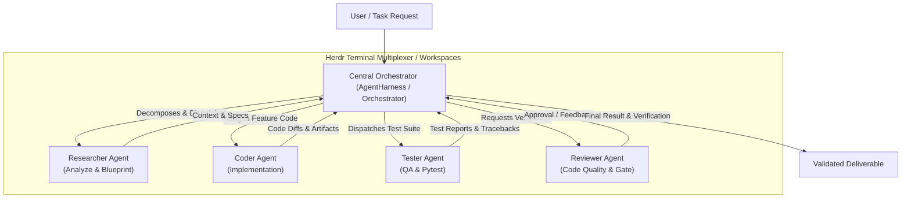

# AGENT.MD: Quy Tắc Tuân Thủ & Kiến Trúc Orchestrator

Tài liệu này xác định toàn bộ quy chuẩn, vai trò, kiến trúc Orchestrator - Worker và quy tắc code bắt buộc mà mọi AI Agent (hoặc developer) phải tuân thủ trong repository **`herness_agent`**.

---

## 1. Kiến Trúc Hệ Thống: Central Orchestrator Pattern

Hệ thống được thiết kế theo mô hình **Central Orchestrator (Nhạc trưởng trung tâm)** điều phối các **Worker Agents (Agent chuyên biệt)**:



### 1.1. Phân Chia Vai Trò (Roles & Responsibilities)

| Vai Trò | Tên Định Danh | Trách Nhiệm Chính |
| :--- | :--- | :--- |
| **Orchestrator** | `orchestrator` | • Là đầu mối trung tâm nhận mục tiêu từ User.<br/>• Phân rã mục tiêu thành Task DAG (Directed Acyclic Graph) có thứ tự phụ thuộc (`depends_on`).<br/>• Điều phối context từ output của task trước sang task sau.<br/>• Quản lý trạng thái (`PENDING`, `RUNNING`, `COMPLETED`, `FAILED`, `BLOCKED`).<br/>• **Không trực tiếp viết code tính năng** nếu đã có worker đảm nhiệm. |
| **Researcher** | `researcher` | • Khảo sát codebase, file liên quan, thư viện, tài liệu.<br/>• Lên kế hoạch kiến trúc chi tiết trước khi code. |
| **Coder** | `coder` | • Viết code tính năng sạch sẽ, tuân thủ chặt chẽ tiêu chuẩn PEP 8 và Typing.<br/>• Chỉ chỉnh sửa trong phạm vi task được giao, không sửa lan man ngoài phạm vi. |
| **Tester** | `tester` | • Viết unit test, integration test với `pytest` và `pytest-asyncio`.<br/>• Chạy test và bảo đảm 100% test pass trước khi chuyển giao. |
| **Reviewer** | `reviewer` | • Đánh giá code diffs, kiểm tra lint, typing, convention, security và chất lượng tổng thể. |

---

## 2. Thiết Lập & Quản Lý Agent Với Herdr (`herdr.dev`)

Herdr là công cụ quản lý terminal workspace chuyên biệt cho AI Coding Agents ("tmux cho AI agents"), giúp duy trì session liên tục, chia pane độc lập cho từng agent và tự động nhận diện trạng thái (`WORKING`, `BLOCKED`, `DONE`, `IDLE`).

### 2.1. Cài Đặt Herdr

- **Trên Windows (PowerShell - Khuyến nghị cho máy này):**
  ```powershell
  powershell -ExecutionPolicy Bypass -c "irm https://herdr.dev/install.ps1 | iex"
  ```
- **Trên Windows (Command Prompt):**
  ```cmd
  curl.exe -fsSLo install.cmd https://herdr.dev/install.cmd && install.cmd && del install.cmd
  ```
- **Trên Linux / macOS / WSL:**
  ```bash
  curl -fsSL https://herdr.dev/install.sh | sh
  ```

### 2.2. Quy Tắc Session Trong Herdr
- **Phân chia Pane / Tab:** Mỗi Worker Agent (`coder`, `tester`, `reviewer`) nên chạy trong một pane hoặc tab riêng biệt trong Herdr workspace.
- **Giám sát Trạng thái:** Orchestrator theo dõi trạng thái của các worker thông qua status bar của Herdr hoặc CLI output trước khi trigger task tiếp theo.

---

## 3. Quy Chuẩn Môi Trường & Thực Thi Code (Code Compliance)

Mọi agent khi thực thi câu lệnh hoặc viết code phải tuân thủ nghiêm ngặt các quy tắc sau:

### 3.1. Conda Environment
- **Bắt buộc:** Luôn sử dụng môi trường Conda **`pytorch`**.
- Khi chạy công cụ bằng CLI / subprocess, dùng cú pháp:
  ```powershell
  conda run -n pytorch <command>
  ```
  *Ví dụ:*
  ```powershell
  conda run -n pytorch pytest
  conda run -n pytorch black --check src tests
  conda run -n pytorch mypy src
  ```

### 3.2. Tiêu Chuẩn Lập Trình Python
- **Python Version:** `>= 3.10` (Hỗ trợ cú pháp hiện đại: `from __future__ import annotations`, Union `|`, pattern matching).
- **Type Annotations:**
  - 100% các hàm, phương thức, thuộc tính công khai phải có type hints đầy đủ.
  - Sử dụng Pydantic v2 cho schema dữ liệu và request/response validation.
- **Code Style & Formatting:**
  - **Black:** Line length = 100 ký tự (`pyproject.toml`).
  - **isort:** Profile `black`, multi-line output = 3.
  - **flake8:** Không để thừa unused imports, biến không dùng, hoặc lỗi cú pháp.
- **Docstrings & Comments:**
  - Mọi module, class, hàm công khai phải có docstring rõ ràng, súc tích (Google style hoặc PEP 257).
  - Không xóa comment hoặc docstrings cũ không liên quan đến task hiện tại.

### 3.3. Tiêu Chuẩn Kiểm Thử (Testing Gates)
- Mọi tính năng mới hoặc chỉnh sửa bug **BẮT BUỘC** phải có unit test đi kèm trong thư mục `tests/`.
- Test suite chạy bằng `pytest` với async support (`pytest-asyncio`):
  ```powershell
  conda run -n pytorch pytest
  ```
- **Quy tắc chặn (Gatekeeper):** Không được coi task là hoàn thành nếu còn bất kỳ test nào thất bại (`exit_code != 0`).

---

## 4. Quy Trình Git & Branching

1. **Tuyệt đối KHÔNG commit trực tiếp vào nhánh `main`**.
2. **Luôn checkout nhánh mới** trước khi thực hiện thay đổi:
   - Tính năng mới: `feat/<tên-tính-năng>` (ví dụ: `feat/orchestrator-architecture`)
   - Sửa lỗi: `fix/<tên-lỗi>`
   - Refactor: `refactor/<tên-module>`
   - Test: `test/<tên-test>`
3. **Quy ước Commit (Conventional Commits):**
   - Format: `<type>(<scope>): <mô tả ngắn bằng tiếng Anh hoặc tiếng Việt>`
   - Ví dụ:
     - `feat(orchestrator): add DAG task resolution and worker prompt builder`
     - `test(orchestrator): add unit tests for cyclic dependency detection`
     - `docs(agent): add Agent.md compliance rules`

---

## 5. Giao Thức Tương Tác Giữa Orchestrator và Worker

### 5.1. Vòng Đời Task (Task Lifecycle)
```text
[PENDING] --> [RUNNING] --> [VALIDATING (Checks/Tests)] --> [COMPLETED]
     |            |
     |            +-------> [FAILED] (Kèm traceback/lý do)
     |
     +--------------------> [BLOCKED / SKIPPED] (Khi upstream task lỗi)
```

### 5.2. Context Passing (Truyền Ngữ Cảnh)
- Khi điều phối một task con đến Worker, Orchestrator phải truyền:
  1. **Mục tiêu tổng thể (`goal`)** của toàn bộ plan.
  2. **Nhiệm vụ cụ thể (`instruction`)** và các ràng buộc kỹ thuật.
  3. **Output tóm tắt từ các task phụ thuộc (`upstream tasks`)**, giúp worker biết rõ các file vừa được tạo/sửa.
- Khi một task thất bại:
  - Orchestrator ghi nhận lỗi chi tiết (`error_message`, `stderr`).
  - Dừng các task phụ thuộc nếu cờ `stop_on_failure: true`.
  - Có thể trigger vòng lặp sửa lỗi (Self-Correction Loop) gửi lại traceback cho Coder sửa.

---

## 6. Lệnh CLI Orchestrator Nhanh

Trong repository này, bạn có thể chạy Orchestrator trực tiếp qua CLI:

```powershell
# Chạy kiểm tra kết nối agy CLI
conda run -n pytorch harness-agent check

# Chạy một kế hoạch điều phối Orchestrator từ file YAML
conda run -n pytorch harness-agent orchestrate examples/orchestrator_plan.yaml -o runs/orchestrator_report.json

# Chạy toàn bộ test suite
conda run -n pytorch pytest
```
