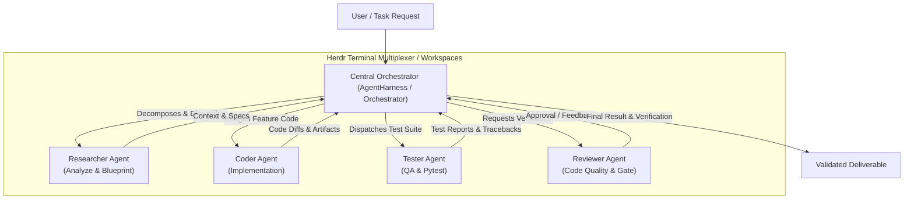

# AGENT.MD: Quy Tắc Tuân Thủ & Kiến Trúc Orchestrator

Tài liệu này xác định toàn bộ quy chuẩn, vai trò, kiến trúc Orchestrator - Worker và quy tắc code bắt buộc mà mọi AI Agent (hoặc developer) phải tuân thủ trong repository **`herness_agent`**.

---

## 1. Kiến Trúc Hệ Thống: Central Orchestrator Pattern

Hệ thống được thiết kế theo mô hình **Central Orchestrator (Nhạc trưởng trung tâm)** điều phối các **Worker Agents (Agent chuyên biệt)**:



### 1.1. Phân Chia Vai Trò (Roles & Responsibilities)

| Vai Trò | Tên Định Danh | Trách Nhiệm Chính |
| :--- | :--- | :--- |
| **Orchestrator** | `orchestrator` | • Là đầu mối trung tâm nhận mục tiêu từ User.<br/>• Phân rã mục tiêu thành Task DAG có thứ tự (`depends_on`).<br/>• Quản lý trạng thái (`PENDING`, `RUNNING`, v.v.).<br/>• **CẤM TUYỆT ĐỐI KHÔNG TRỰC TIẾP VIẾT CODE**. Chỉ được phép: 1) Viết Sub-Spec và lưu vào `.ai/[task_id].md`, 2) Chờ User duyệt, 3) Tạo worktree mới (`git worktree add agent/[task_id]`), 4) Tạo và focus workspace hiển thị trên Herdr bằng lệnh `herdr workspace create --cwd [đường dẫn tuyệt đối tới worktree] --focus`. 5) BẮT BUỘC KHÔNG ĐƯỢC CHẠY `agy` NGẦM. Lấy `pane_id` từ kết quả trả về của Herdr và dùng `herdr pane run <pane_id> "agy -p '...'"` để kích hoạt agent có thể nhìn thấy được trên Herdr. |
| **Researcher** | `researcher` | • Khảo sát codebase, file liên quan, thư viện, tài liệu.<br/>• Lên kế hoạch kiến trúc chi tiết trước khi code. |
| **Coder** | `coder` | • Viết code tính năng sạch sẽ, tuân thủ chặt chẽ tiêu chuẩn PEP 8 và Typing.<br/>• Chỉ chỉnh sửa trong phạm vi task được giao, không sửa lan man ngoài phạm vi. |
| **Tester** | `tester` | • Viết unit test, integration test với `pytest` và `pytest-asyncio`.<br/>• Chạy test và bảo đảm 100% test pass trước khi chuyển giao. |
| **Reviewer** | `reviewer` | • Đánh giá code diffs, kiểm tra lint, typing, convention, security và chất lượng tổng thể. |

---

## 2. Thiết Lập & Quản Lý Agent Với Herdr (`herdr.dev`)

Herdr là công cụ quản lý terminal workspace chuyên biệt cho AI Coding Agents ("tmux cho AI agents"), giúp duy trì session liên tục, chia pane độc lập cho từng agent và tự động nhận diện trạng thái (`WORKING`, `BLOCKED`, `DONE`, `IDLE`).

### 2.1. Cài Đặt Herdr

- **Trên Windows (PowerShell - Khuyến nghị cho máy này):**
  ```powershell
  powershell -ExecutionPolicy Bypass -c "irm https://herdr.dev/install.ps1 | iex"
  ```
- **Trên Windows (Command Prompt):**
  ```cmd
  curl.exe -fsSLo install.cmd https://herdr.dev/install.cmd && install.cmd && del install.cmd
  ```
- **Trên Linux / macOS / WSL:**
  ```bash
  curl -fsSL https://herdr.dev/install.sh | sh
  ```

### 2.2. Quy Tắc Session Trong Herdr
- **Phân chia Pane / Tab:** Mỗi Worker Agent (`coder`, `tester`, `reviewer`) nên chạy trong một pane hoặc tab riêng biệt trong Herdr workspace.
- **Giám sát Trạng thái:** Orchestrator theo dõi trạng thái của các worker thông qua status bar của Herdr hoặc CLI output trước khi trigger task tiếp theo.

---

## 3. Quy Chuẩn Môi Trường & Thực Thi Code (Code Compliance)

Mọi agent khi thực thi câu lệnh hoặc viết code phải tuân thủ nghiêm ngặt các quy tắc sau:

### 3.1. Conda Environment
- **Bắt buộc:** Luôn sử dụng môi trường Conda **`pytorch`**.
- Khi chạy công cụ bằng CLI / subprocess, dùng cú pháp:
  ```powershell
  conda run -n pytorch <command>
  ```
  *Ví dụ:*
  ```powershell
  conda run -n pytorch pytest
  conda run -n pytorch black --check src tests
  conda run -n pytorch mypy src
  ```

### 3.2. Tiêu Chuẩn Lập Trình Python
- **Python Version:** `>= 3.10` (Hỗ trợ cú pháp hiện đại: `from __future__ import annotations`, Union `|`, pattern matching).
- **Type Annotations:**
  - 100% các hàm, phương thức, thuộc tính công khai phải có type hints đầy đủ.
  - Sử dụng Pydantic v2 cho schema dữ liệu và request/response validation.
- **Code Style & Formatting:**
  - **Black:** Line length = 100 ký tự (`pyproject.toml`).
  - **isort:** Profile `black`, multi-line output = 3.
  - **flake8:** Không để thừa unused imports, biến không dùng, hoặc lỗi cú pháp.
- **Docstrings & Comments:**
  - Mọi module, class, hàm công khai phải có docstring rõ ràng, súc tích (Google style hoặc PEP 257).
  - Không xóa comment hoặc docstrings cũ không liên quan đến task hiện tại.

### 3.3. Tiêu Chuẩn Kiểm Thử (Testing Gates)
- Mọi tính năng mới hoặc chỉnh sửa bug **BẮT BUỘC** phải có unit test đi kèm trong thư mục `tests/`.
- Test suite chạy bằng `pytest` với async support (`pytest-asyncio`):
  ```powershell
  conda run -n pytorch pytest
  ```
- **Quy tắc chặn (Gatekeeper):** Không được coi task là hoàn thành nếu còn bất kỳ test nào thất bại (`exit_code != 0`).

---

## 4. Quy Trình Git & Quản Lý Qua `agy` CLI Trực Tiếp (Không Gọi Bằng Code)

Mọi thao tác Git (tạo nhánh, commit, kiểm tra diff, push) **phải được thực thi trực tiếp thông qua công cụ CLI của `agy` (Terminal / Command Tool)**, tuyệt đối không gọi qua code:

1. **Nguyên tắc phân tách (Separation of Concerns):**
   - Codebase Python (`src/harness_agent/`) **không chứa bất kỳ hàm nào gọi ngầm Git** (không dùng `subprocess.run(["git", ...])` hay thư viện như `GitPython` trong mã nguồn).
   - Quyền điều khiển Git hoàn toàn do **`agy` CLI** thực hiện tương tác theo lệnh và sự giám sát của người dùng.
2. **Quy tắc thao tác Git qua `agy`:**
   - **Tuyệt đối KHÔNG commit trực tiếp vào nhánh `main`**.
   - **Luôn bảo `agy` checkout nhánh mới** trước khi thực hiện task:
     ```powershell
     # Ví dụ lệnh prompt cho agy:
     agy "Tạo và chuyển sang nhánh mới feat/ten-tinh-nang"
     ```
   - **Commit có chủ đích và tuân thủ Conventional Commits:**
     - Trước khi commit, `agy` phải chạy `git status` và `git diff` để kiểm tra chính xác các file đã thay đổi.
     - Sau đó `agy` chạy lệnh commit:
       ```powershell
       agy "Kiểm tra thay đổi và commit theo chuẩn conventional commit feat(scope): message"
       ```
   - **Quy ước đặt tên Conventional Commits:**
     - `feat(...)`: Tính năng mới
     - `fix(...)`: Sửa lỗi
     - `refactor(...)`: Tái cấu trúc mã nguồn
     - `test(...)`: Bổ sung hoặc cập nhật bài kiểm thử
     - `docs(...)`: Cập nhật tài liệu / quy chuẩn


---

## 5. Giao Thức Tương Tác Giữa Orchestrator và Worker

### 5.1. Vòng Đời Task (Task Lifecycle)
```text
[PENDING] --> [RUNNING] --> [VALIDATING (Checks/Tests)] --> [COMPLETED]
     |            |
     |            +-------> [FAILED] (Kèm traceback/lý do)
     |
     +--------------------> [BLOCKED / SKIPPED] (Khi upstream task lỗi)
```

### 5.2. Context Passing (Truyền Ngữ Cảnh)
- Khi điều phối một task con đến Worker, Orchestrator phải truyền:
  1. **Mục tiêu tổng thể (`goal`)** của toàn bộ plan.
  2. **Nhiệm vụ cụ thể (`instruction`)** và các ràng buộc kỹ thuật.
  3. **Output tóm tắt từ các task phụ thuộc (`upstream tasks`)**, giúp worker biết rõ các file vừa được tạo/sửa.
- Khi một task thất bại:
  - Orchestrator ghi nhận lỗi chi tiết (`error_message`, `stderr`).
  - Dừng các task phụ thuộc nếu cờ `stop_on_failure: true`.
  - Có thể trigger vòng lặp sửa lỗi (Self-Correction Loop) gửi lại traceback cho Coder sửa.

---

## 6. Tuân Thủ Bộ SDLC Skills Trước & Sau Khi Làm Task

Mọi AI Agent làm việc trong repository này (hoặc repository phái sinh) **BẮT BUỘC** phải tuân thủ quy trình SDLC chuẩn hóa thông qua các skills nằm trong thư mục `.agents/skills/`:

### 6.1. Giai Đoạn 1: Trước Khi Làm Task (Pre-Task Phase)
1. **`sdlc-pretask-checklist`**:
   - Chạy `git status` đảm bảo working tree sạch sẽ.
   - Kiểm tra nhánh hiện tại; nếu đang ở `main`, bắt buộc checkout sang nhánh mới: `git checkout -b feat/...` hoặc `fix/...`.
   - Phân rã yêu cầu thành các tiêu chí nghiệm thu (Acceptance Criteria).
2. **`sdlc-architecture-planner`**:
   - Khảo sát codebase, kiểm tra các model/hàm có sẵn để tái sử dụng.
   - Định nghĩa schema dữ liệu với Pydantic v2 và typing đầy đủ trước khi viết logic thực thi.
   - Lập kế hoạch DAG các bước thực hiện.
3. **`sdlc-subtask-specifier` (Bắt Buộc Trước Khi Giao Việc Cho Worker)**:
   - Orchestrator/Researcher lập bản đặc tả kỹ thuật con (`sub-spec`) cho từng subtask.
   - Đánh giá **mức độ quan trọng (Criticality)**: `CRITICAL`, `HIGH`, `MEDIUM`, `LOW`.
   - Đánh giá **rủi ro (Risk Assessment)**: mức độ rủi ro, khả năng lỗi, blast radius, phương án rollback.
   - Quản lý **trạng thái (Status)**: `DRAFT`, `APPROVED`, `IN_PROGRESS`, `TESTING`, `COMPLETED`, `BLOCKED`.
   - Đặc tả chi tiết **chữ ký hàm (Function Specs)**: tên hàm, tham số, kiểu trả về, ngoại lệ ném ra.
   - Liệt kê trước **danh sách testcase (TestCase Specs)**: happy path, boundary/edge cases, error cases.

### 6.2. Giai Đoạn 2: Trong Khi Làm Task (Implementation Phase)
1. **`sdlc-clean-code-standards`**:
   - Tuân thủ PEP 8, Black (100 ký tự), isort, flake8.
   - Không nuốt ngoại lệ (silent errors), xử lý lỗi tường minh.
   - Giữ nguyên vẹn comments và docstrings của mã nguồn hiện hữu.
2. **`sdlc-test-driven-development` (TDD / QA)**:
   - Viết bài test tương ứng trong `tests/` với `pytest` và `pytest-asyncio`.
   - Bao quát happy path, edge cases và error cases.

### 6.3. Giai Đoạn 3: Sau Khi Làm Task (Post-Task Phase / Quality Gate)
1. **`sdlc-posttask-quality-gate`**:
   - **Bắt buộc:** Chạy `conda run -n pytorch pytest` ➔ Phải pass 100%.
   - Chạy lint checks: Black, isort, flake8.
   - Chạy `git diff` kiểm tra dòng thay đổi, đảm bảo không sót file rác hoặc debug print.
2. **`sdlc-security-audit`**:
   - Kiểm tra không để lọt API keys, mật khẩu, credentials vào file code.
   - Rà soát các lệnh subprocess, sanitize input chống injection.
3. **`sdlc-conventional-commit`**:
   - Thao tác Git trực tiếp qua `agy-cli` terminal.
   - Viết commit message theo chuẩn Conventional Commits (`feat:`, `fix:`, `test:`, `docs:`).

---

## 7. Lệnh CLI Orchestrator Nhanh

Trong repository này, bạn có thể chạy Orchestrator trực tiếp qua CLI:

```powershell
# Chạy kiểm tra kết nối agy CLI
conda run -n pytorch harness-agent check

# Khởi tạo bộ rules & skills cho một repo mới
conda run -n pytorch harness-agent init "..\du-an-moi"

# Đồng bộ cập nhật quy chuẩn & SDLC skills sang repo làm việc
conda run -n pytorch harness-agent sync "..\du-an-moi"

# Hoặc đồng bộ TẤT CẢ các repo đã khởi tạo
conda run -n pytorch harness-agent sync --all

# Đồng bộ với liên kết tự động cập nhật (Live Symlink/Junction)
conda run -n pytorch harness-agent sync "..\du-an-moi" --link

### 7.1. Quy Tắc Cập Nhật Quy Chuẩn (Chỉ Cập Nhật Trên Nhánh `main`)
- **Nguyên tắc an toàn:** Mọi thao tác đồng bộ (`sync.ps1`, `sync.sh`, hoặc `harness-agent sync`) **CHỈ ĐƯỢC PHÉP THỰC HIỆN TRÊN NHÁNH `main`** của repo làm việc.
- **Lý do:** Tuyệt đối không cập nhật quy chuẩn thẳng vào các nhánh tính năng (`feat/...`) đang code dở để tránh gây xung đột mã nguồn (git conflict) hoặc làm rối loạn lịch sử commit của tính năng.
- **Quy trình chuẩn khi có bản cập nhật mới từ `harness_agent`:**
  1. Chuyển về nhánh `main` của repo làm việc:
     ```powershell
     cd ..\du-an-moi
     git checkout main
     ```
  2. Kéo cập nhật từ repo gốc:
     ```powershell
     cd ..\herness_agent
     .\sync.ps1 -TargetDir "..\du-an-moi"
     ```
  3. Commit bản cập nhật trên nhánh `main`:
     ```powershell
     cd ..\du-an-moi
     git add .
     git commit -m "chore: sync latest SDLC rules and skills from harness_agent"
     ```
  4. Nếu bạn đang làm việc trên nhánh tính năng `feat/xyz`, hãy merge `main` vào nhánh của bạn:
     ```powershell
     git checkout feat/xyz
     git merge main
     ```
