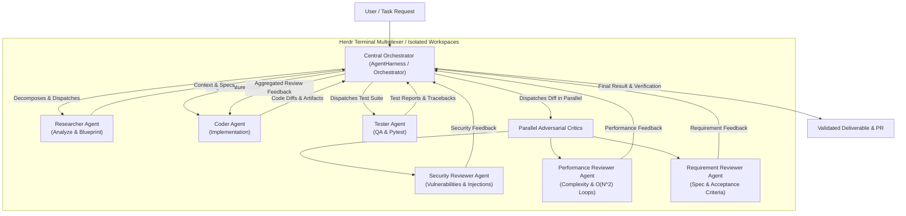

# Harness Agent 🤖⚡

> An evaluation, benchmarking, and orchestration harness for AI agents powered by the **Google Antigravity (`agy`) CLI**.

---

## 📌 Overview

**Harness Agent** is an enterprise-grade AI Agent orchestration, benchmarking, and SDLC governance framework built on top of the **Google Antigravity (`agy`) CLI**.

It serves a dual mission:
1. **Agent Orchestration & SDLC Governance**: Enforces rigorous Software Development Life Cycle (SDLC) discipline across autonomous agents through a Central Orchestrator pattern, role isolation, specialized SDLC skills (`.agents/skills/`), strict branch protection, and automated pull request generation.
2. **Evaluation & Benchmarking Engine**: Provides an automated test and evaluation harness to execute, stream, validate, and benchmark coding agents via `agy`, tracking real-time thoughts, tool calls, workspace artifacts, and assertion passes.

---

## 🏛️ System Architecture



### Core Architecture Pillars

- **Central Orchestrator Pattern**: Orchestrator decomposes high-level goals into Task DAGs and Sub-Specs, coordinates workers in isolated Herdr workspaces (`git worktree`), aggregates adversarial critic reviews, and guarantees zero unvetted modifications to main branches.
- **Rule 0 Code-Writing Lock**: Orchestrators never touch application code directly; all code modifications are performed by dedicated Coder agents following a strict "Patch, Never Regenerate" diff-hunk policy.
- **SDLC Skills & Protocol Engine**: Standardized operational skills in `.agents/skills/` guide agents across pre-task planning, architecture design, clean code standards, test-driven development, security auditing, and conventional commits.
- **Real-Time NDJSON Stream Parsing**: Streams raw agent events from `agy` CLI, capturing inner thoughts, tool invocations, stdout/stderr tokens, and execution durations.
- **Pluggable Evaluation Checks**: Validates task outcomes via file presence (`file_exists`), regex/substring patterns (`text_match`), and test commands (`command_exit_zero`).
- **Automated Pull Request Engine**: Gathers git commits, diff stats, and verification evidence to automatically populate PR templates and submit PRs via `gh` CLI.

---

## 🚀 Key Features

- **Direct `agy` CLI Integration**: Wraps `agy` execution with configurable models (e.g. `gemini-2.5-pro`, `gemini-2.5-flash`), reasoning effort levels (`low`, `medium`, `high`, `max`), timeouts, and permissions (`--dangerously-skip-permissions`).
- **3-Tier Planning Architecture**: Standardized plan storage in `.ai/plans/main/YYYY-MM-DD/`, subtasks in `.ai/plans/subtasks/YYYY-MM-DD/[plan_id]/`, decisions in `.ai/decisions/`, and persistent context in `.ai/context/`.
- **Project Scaffolding (`install.ps1` / `install.sh`)**: One-command bootstrap to inject `AGENTS.md`, SDLC skills, lifecycle hooks, and pre-commit branch protection into any existing or new repository.
- **Multi-Project Synchronization (`sync.ps1` / `sync.sh` / `harness-agent sync`)**: Keep rules and SDLC skills in sync across all registered repositories with built-in "Main Branch Only" safety gates.
- **Adversarial Critic Quality Gates**: Parallel evaluation by Security Reviewer, Performance Reviewer, and Requirement Reviewer before code hand-off.
- **Research & Verification Toolkit**: Integrated AI paper search (`scholar-search`), safe web scraping (`web-crawl`), DuckDuckGo search (`web-search`), and citation claim auditing (`cite-check`).
- **Developer Hygiene**: Fully equipped with `pre-commit` (formatting, linting, `black`, `isort`, `flake8`) and `pytest`.

---

## 🛠️ Repository Structure

```
herness_agent/
├── AGENTS.md                    # Unified system rule file & architecture guidelines
├── install.ps1 / install.sh     # Project scaffolding scripts (Windows / Linux)
├── sync.ps1 / sync.sh           # Rule & SDLC skill synchronization scripts
├── pyproject.toml               # Build configuration, CLI entry points & deps
├── README.md                    # Project documentation & reference guide
├── .pre-commit-config.yaml      # Branch protection & linters (black, isort, flake8)
├── .agents/
│   ├── hooks.json               # Agent lifecycle hook triggers
│   ├── hooks/                   # Lifecycle hooks script implementation
│   └── skills/                  # Specialized SDLC skills (pre-task, clean code, TDD, audit)
├── .ai/                         # 3-tier planning architecture
│   ├── plans/
│   │   ├── main/                # Master Task DAG plans (YYYY-MM-DD/main_[plan_id].md)
│   │   └── subtasks/            # Decomposed sub-specs (YYYY-MM-DD/[plan_id]/subtask_*.md)
│   ├── decisions/               # Architecture Decision Records (ADRs)
│   └── context/                 # Persistent project context & schemas
├── examples/
│   ├── sample_suite.yaml        # Benchmark evaluation suite example
│   └── orchestrator_plan.yaml   # Multi-agent orchestrator plan example
├── src/
│   └── harness_agent/
│       ├── __init__.py          # Package exports
│       ├── __main__.py          # Entrypoint for python -m harness_agent
│       ├── cli.py               # Click CLI (check, run-prompt, orchestrate, sync, pr...)
│       ├── core/                # Orchestrator, runner, dispatch, PR generator, critics
│       ├── evaluation/          # Pluggable evaluation assertions (file, regex, commands)
│       ├── hooks/               # Lifecycle hooks script implementation
│       ├── research/            # AI paper search (arXiv, OpenAlex) and citation checker
│       └── web/                 # Web search (DuckDuckGo) and safe scrapers (crawl4ai)
└── tests/                       # Pytest test suite
```

---

## 📋 Prerequisites

Before using Harness Agent, verify that your environment satisfies the following prerequisites:

| Tool | Minimum Version | Installation / Reference |
| :--- | :--- | :--- |
| **Conda** | `>= 23.0` | Active **`pytorch`** environment with Python `>= 3.10` |
| **Antigravity CLI (`agy`)** | Latest | Google Antigravity CLI installed and available on PATH |
| **Herdr Multiplexer** | Latest | Terminal multiplexer for isolated workspaces ([`herdr.dev`](https://herdr.dev)) |
| **GitHub CLI (`gh`)** | `>= 2.0` | CLI for automated PR submission and authentication |
| **Git** | `>= 2.30` | Version control with worktree support |

---

## ⚡ Installation & Setup

### 1. Clone & Activate Conda Environment

Always run Harness Agent inside the designated `pytorch` Conda environment:

```powershell
# Clone the repository
git clone https://github.com/Khanhduong123/herness_agent.git
cd herness_agent

# Activate the mandatory Conda environment
conda activate pytorch

# Install the package in editable mode with development dependencies
pip install -e .
```

### 2. Install Git Pre-Commit Hooks

Enforce automated code formatting (`black`, `isort`), linting (`flake8`), and strict branch protection:

```powershell
pre-commit install
```

To run all hooks manually across the entire codebase:

```powershell
pre-commit run --all-files
```

### 3. Verify Environment Connectivity

Validate that `agy` is recognized, runnable, and responsive:

```powershell
conda run -n pytorch harness-agent check
```

---

## 🏗️ Project Scaffolding (`install.ps1` & `install.sh`)

Bootstrap new or existing repositories with complete Harness Agent governance, SDLC skills, lifecycle hooks, and the 3-tier planning architecture.

### What Scaffolding Injects:
- `AGENTS.md`: Unified system rules and Central Orchestrator architecture guidelines.
- `.pre-commit-config.yaml`: Branch protection (`no-commit-to-branch` for `main`, `master`, `dev`, `develop`) and linters.
- `.agents/skills/`: Complete suite of specialized SDLC skills (pre-task checklist, clean code, TDD, security audit, conventional commit).
- `.agents/hooks.json` & `.agents/hooks/`: Lifecycle hook triggers for orchestrators and workers.
- `.ai/` directory structure: Planning tiers (`.ai/plans/main/`, `.ai/plans/subtasks/`, `.ai/decisions/`, `.ai/context/`).
- `examples/orchestrator_plan.yaml`: Sample multi-agent Task DAG template.
- `.gitignore`: AI orchestrator exclusions and project hygiene.
- `~/.harness/projects.json`: Automatically registers the target repository for automated future syncs.

### Windows (PowerShell)

```powershell
# Interactive wizard (prompts for project name if run inside harness_agent)
.\install.ps1

# Specify project name (creates or updates ../my-app)
.\install.ps1 -ProjectName "my-app"

# Specify custom target directory
.\install.ps1 -TargetDir "D:\projects\my-app"

# Non-interactive force mode (safely updates existing projects without prompt)
.\install.ps1 -TargetDir "..\existing-project" -Force
```

### Linux / macOS (Bash)

```bash
# Interactive setup
./install.sh

# Specify project name
./install.sh my-app

# Specify project name and target path
./install.sh my-app /path/to/my-app

# Force non-interactive update
FORCE=true ./install.sh my-app /path/to/my-app
```

> [!NOTE]
> **Non-Destructive Guarantee**: When run against an existing project with existing code, `install.ps1` and `install.sh` will **never** delete or overwrite existing source code. They only inject governance files, skills, and planning directories.

---

## 🔄 Synchronizing Rules & Skills (`sync.ps1`, `sync.sh` & CLI)

As SDLC skills and system rules in `harness_agent` evolve, synchronize updates across your active repositories.

### Synchronization Commands

```powershell
# Windows PowerShell
.\sync.ps1 -All                                 # Sync all registered projects in ~/.harness/projects.json
.\sync.ps1 -TargetDir "..\my-app"               # Sync a specific project
.\sync.ps1 -TargetDir "..\my-app" -Link         # Create live symlink/junction for live skill development

# Linux / macOS Bash
./sync.sh --all                                 # Sync all registered projects
./sync.sh ../my-app                             # Sync specific target directory
./sync.sh ../my-app --link                      # Symlink skills for real-time updates

# Direct Python CLI
conda run -n pytorch harness-agent sync --all
conda run -n pytorch harness-agent sync ../my-app --link
```

### 🛡️ "Main Branch Only" Safety Guard

Both `sync.ps1` and `sync.sh` enforce a strict safety rule: **Updates are ONLY allowed on the `main` or `master` branch of target projects.**

If a target project is currently on a feature branch (e.g. `feat/auth`, `agent/subtask_01`):
1. The sync command will **reject** the operation to prevent merge conflicts or unstaged diff leaks in your working branch.
2. Follow the standard update workflow:
   ```bash
   cd /path/to/target-project
   git checkout main
   # Now run sync from harness_agent:
   .\sync.ps1 -TargetDir /path/to/target-project
   # Switch back to your feature branch and pull the new rules:
   git checkout feat/my-feature
   git merge main
   ```

---

## 💻 CLI Command Reference

Harness Agent provides a rich CLI accessible via `conda run -n pytorch harness-agent <command>` or `python -m harness_agent <command>`.

### 1. Verification & Inspection

```powershell
# Verify agy CLI installation, version, and execution capability
conda run -n pytorch harness-agent check

# Specify custom agy executable path
conda run -n pytorch harness-agent check --executable "C:\path\to\agy.exe"
```

### 2. Ad-Hoc Agent Execution (`run-prompt`)

Run a single prompt directly through the `agy` CLI with configurable effort and safety controls:

```powershell
# Basic execution
conda run -n pytorch harness-agent run-prompt "Write a Python function to compute Fibonacci numbers"

# Advanced flags
conda run -n pytorch harness-agent run-prompt "Refactor utils.py to use async/await" `
  --model gemini-2.5-pro `
  --effort high `
  --timeout 180 `
  --dangerously-skip-permissions
```

| Flag | Default | Description |
| :--- | :--- | :--- |
| `--model` | `None` | Target LLM model (e.g. `gemini-2.5-pro`, `gemini-2.5-flash`) |
| `--effort` | `None` | Reasoning effort level (`low`, `medium`, `high`, `max`) |
| `--mode` | `None` | Agent mode (`plan`, `accept-edits`) |
| `--timeout` | `120` | Execution timeout ceiling in seconds |
| `--dangerously-skip-permissions` | `True` | Automatically approves tool execution without prompting |

### 3. Benchmark Suite Evaluation (`run-suite`)

Execute automated test and benchmark suites defined in YAML/JSON to evaluate agent capabilities and measure pass rates:

```powershell
conda run -n pytorch harness-agent run-suite examples/sample_suite.yaml --output runs/eval_report.json
```

Sample Suite Definition ([`examples/sample_suite.yaml`](examples/sample_suite.yaml)):
```yaml
suite_name: "Code Generation Suite"
tasks:
  - id: "task_01"
    name: "Generate Greeting Function"
    prompt: "Create a greeting function in greeting.py that returns 'Hello World'"
    checks:
      - type: "file_exists"
        target: "greeting.py"
      - type: "command_exit_zero"
        target: "python -c \"import greeting; assert greeting.greet() == 'Hello World'\""
```

Available Evaluation Checks:
- `file_exists`: Validates file or directory creation in the target workspace.
- `text_match`: Validates output text against expected regex or substring patterns.
- `command_exit_zero`: Executes verification commands (e.g., `pytest`, linters) and checks exit code 0.

### 4. Multi-Agent Orchestration (`orchestrate` & `resume`)

Execute multi-agent Task DAGs coordinating specialized workers (Researcher, Coder, Tester, Critics) with state persistence in SQLite:

```powershell
# Run a full orchestrator plan
conda run -n pytorch harness-agent orchestrate examples/orchestrator_plan.yaml --output runs/orchestration_report.json

# Resume interrupted run
conda run -n pytorch harness-agent resume

# Resume specific plan by ID
conda run -n pytorch harness-agent resume plan_auth_refactor
```

### 5. Herdr Workspace Dispatch (`dispatch`)

Interactively create an isolated `git worktree` and dispatch a specialized Coder agent inside a Herdr terminal pane:

```powershell
# Dispatch worker with a specific sub-spec file
conda run -n pytorch harness-agent dispatch `
  --task-id subtask_01_api `
  --spec-file .ai/plans/subtasks/2026-10-05/plan_feature/subtask_01_api.md `
  --kind agy `
  --dangerously-skip-permissions

# Dispatch worker with custom prompt override
conda run -n pytorch harness-agent dispatch `
  --task-id subtask_02_db `
  --prompt "Implement SQLAlchemy models in src/db/models.py with 100% test coverage"
```

### 6. Automated Pull Request Automation (`pr fill` & `pr create`)

Automatically inspect git commit history, diff stats, and environment details to populate the GitHub PR template (`.github/pull_request_template.md`), push to remote, and create the PR:

```powershell
# Preview populated PR template markdown
conda run -n pytorch harness-agent pr fill --base main

# Generate PR markdown and write to file
conda run -n pytorch harness-agent pr fill --base main --output .github/PR_PREVIEW.md

# Dry-run PR creation (verifies title and body generation)
conda run -n pytorch harness-agent pr create --base main --dry-run

# Push branch and create PR via GitHub CLI (or fallback to browser link)
conda run -n pytorch harness-agent pr create --base main --title "feat: implement caching layer" --issue 42
```

### 7. Scholarly AI Paper Research (`scholar-search`)

Retrieve academic papers and citations from arXiv and OpenAlex:

```powershell
# Search AI papers
conda run -n pytorch harness-agent scholar-search "Agentic Workflow Orchestration" --limit 5

# Filter by provider and output JSON
conda run -n pytorch harness-agent scholar-search "Diffusion Transformers" --provider arxiv --json
```

### 8. Web Search & Safe Scraping (`web-search` & `web-crawl`)

Execute free web searches via DuckDuckGo and safely extract markdown from web pages with built-in SSRF protections:

```powershell
# DuckDuckGo search (no API keys required)
conda run -n pytorch harness-agent web-search "Antigravity CLI documentation" --limit 5

# Safe web crawl (using crawl4ai or fast safe_http)
conda run -n pytorch harness-agent web-crawl "https://github.com/Khanhduong123/herness_agent"

# Fast crawl without headless browser
conda run -n pytorch harness-agent web-crawl "https://docs.python.org/3/" --no-browser
```

### 9. Citation & Claim Verification (`cite-check`)

Audit reports and documents to verify that factual claims are substantiated by source documents:

```powershell
conda run -n pytorch harness-agent cite-check report.md --sources-dir ./sources/
```

---

## 🧪 Testing & Quality Gates

Harness Agent enforces strict testing gates for all feature code and orchestrator deliverables.

### Running Pytest

Run the comprehensive test suite with coverage:

```powershell
conda run -n pytorch pytest -v
```

### Running Linters & Code Hygiene

Run pre-commit hooks to format and lint code before submitting commits:

```powershell
conda run -n pytorch pre-commit run --all-files
```

### SDLC Quality Gate Acceptance Criteria

All tasks within the Harness Agent framework must satisfy:
1. **Zero-Tolerance Code-Writing Lock**: Orchestrators never edit application code directly.
2. **"Patch, Never Regenerate"**: Existing files modified strictly via atomic diff hunks.
3. **Branch Protection**: Direct commits and automated merges to `main`/`master`/`dev` are blocked.
4. **100% Pytest Pass Rate**: Tasks cannot be marked complete if tests fail.
5. **Adversarial Critic Consensus**: Security, Performance, and Requirement critics must review diffs.

---

## 📝 License

Distributed under the **MIT License**. See `LICENSE` for details.
